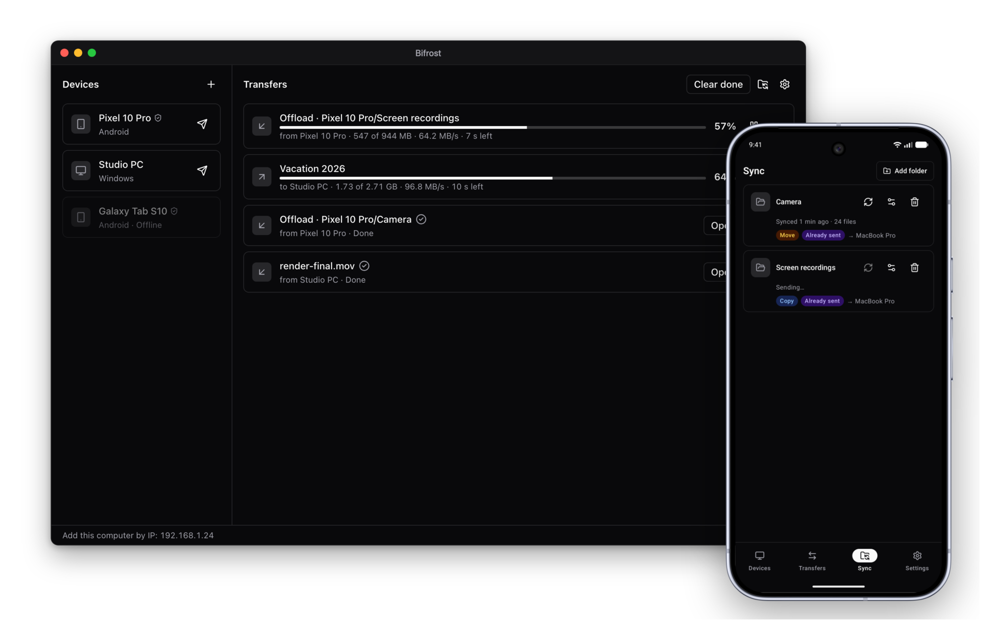

# Bifrost

Fast, encrypted file and clipboard sharing over your local network, for Windows, macOS and Android.
No cloud, no account, no size limit. Transfers survive Wi-Fi drops, sleep and app restarts.

## Download

**[Get the latest release →](https://github.com/AmrEsam0/bifrost-app/releases/latest)**

| Platform | File on the release page |
|---|---|
| macOS (Apple Silicon) | `Bifrost_<version>_aarch64.dmg` |
| Windows 10 / 11 (x64) | `Bifrost_<version>_x64-setup.exe` |
| Android | [Get it on Google Play](https://play.google.com/store/apps/details?id=com.nullchecklabs.bifrost) |

### First launch

The installers aren't signed yet, so your system asks once:

| System | What to do |
|---|---|
| macOS | Open Bifrost once, then System Settings → Privacy & Security → **Open Anyway**. Or run `xattr -dr com.apple.quarantine /Applications/Bifrost.app` |
| Windows | SmartScreen says "Windows protected your PC" → **More info** → **Run anyway** |

## Features

| Feature | What it does |
|---|---|
| Finds your devices | Devices on the same Wi-Fi show up by themselves. If your network hides them, add one by its IP address once. |
| Files and folders | Pick them or drag them onto a device. Folders keep their structure, empty folders included. |
| Share from any app | On Android, Bifrost is in the share menu of Google Photos, Files, your browser and any other app. Text and links go to the other device's clipboard. |
| You decide what arrives | Every incoming transfer shows who's sending, how much, and a 6-digit code to match on both screens. "Always accept" skips the question for your own devices. |
| Offload folders | Pick a folder, like your phone's Camera, and a computer. New files go over by themselves, and never twice. Copy keeps them; Move frees up space once the computer has saved them. |
| Copy here, paste there | Send copied text to another device. Your own devices copy it right away; others ask first. |
| Never start over | Pause, resume or cancel from either side, for a whole transfer or a single file. After a Wi-Fi drop, sleep or a restart, it picks up where it stopped. |
| Live progress | Speed and time left for every transfer and every file, incoming and outgoing in one list. |
| Private and secure | Always encrypted (TLS 1.3, a key for each device). Every piece of every file is checked on arrival. No cloud, no account, no ads, no tracking. |
| Stays out of the way | Desktop lives in the tray and keeps receiving with the window closed. Android keeps transfers going in the background. Light and dark themes. |

## About

Bifrost is made by **NullCheck Labs**. Questions or feedback: [nullchecklabs@gmail.com](mailto:nullchecklabs@gmail.com).
